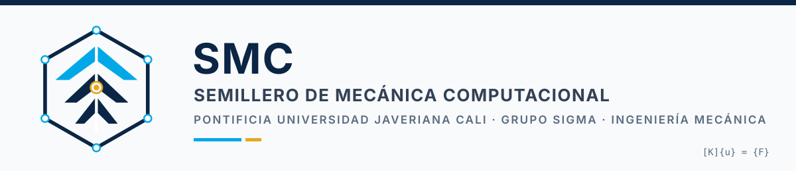
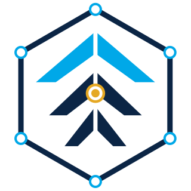
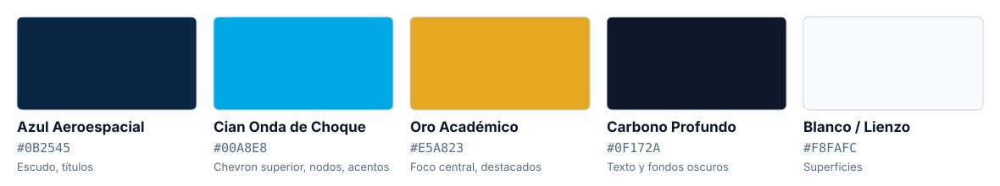

<div align="center">

<picture>
  <source media="(prefers-color-scheme: dark)" srcset="recursos/marca/smc-banner-oscuro.svg">
  
</picture>


</div>

---

## Tabla de contenidos

- [Descripción](#descripción)
- [Ficha del semillero](#ficha-del-semillero)
- [Objetivos](#objetivos)
- [Enfoque y herramientas](#enfoque-y-herramientas)
- [Problema que aborda](#problema-que-aborda)
- [Metodología](#metodología)
- [Líneas de operación](#líneas-de-operación)
- [Avances 2026](#avances-2026)
- [Cronograma](#cronograma)
- [Productos esperados](#productos-esperados)
- [Estructura del repositorio](#estructura-del-repositorio)
- [Identidad visual](#identidad-visual)
- [Equipo](#equipo)
- [Cómo contribuir](#cómo-contribuir)
- [Contacto](#contacto)

---

## Descripción

El Semillero de Mecánica Computacional es un semillero de investigación registrado en la Convocatoria de Semilleros de Investigación 2026 de la Pontificia Universidad Javeriana – Cali. Está vinculado al grupo de investigación SIGMA y al programa de Ingeniería Mecánica.

Su propósito es formar estudiantes de ingeniería con capacidad crítica frente a las herramientas de simulación: los integrantes programan sus propios métodos numéricos (Python/Jupyter) y contrastan los resultados contra software de simulación (FreeCAD). De esta forma comprenden los fundamentos físicos y matemáticos de cada simulación en lugar de usar las herramientas como una caja negra.

Este repositorio es el espacio de trabajo del semillero. Documenta el avance de las líneas de operación definidas por el grupo, las actas de las sesiones y el material de formación y divulgación que se produzca.

---

## Ficha del semillero

| Campo | Información |
|---|---|
| Nombre | Semillero de Mecánica Computacional |
| Institución | Pontificia Universidad Javeriana – Cali, Facultad de Ingeniería |
| Grupo de investigación | SIGMA |
| Programa académico | Ingeniería Mecánica |
| Tipo de propuesta | Nuevo semillero (Convocatoria Semilleros de Investigación 2026) |
| Tutor | Jaime Andrés Vélez Zea |
| Correo del tutor | jaimea.velez@javerianacali.edu.co |
| Fecha de inicio de ejecución | 06/04/2026 (fija) |
| Fecha de fin de ejecución | 30/11/2027 (fija) |
| Eje estratégico | Desarrollo humano, paz, equidad y democracia |
| ODS abordados | ODS 4 — Educación de calidad; ODS 9 — Industria, innovación e infraestructura |
| Gran área / Área | Ingeniería y Tecnología / Ingeniería Mecánica |
| Objetivo socioeconómico | Producción y tecnología industrial |

---

## Objetivos

**Objetivo general**

Desarrollar competencias investigativas en estudiantes de ingeniería a través de una metodología híbrida que integra la programación de métodos numéricos y el uso de software de simulación, para la resolución de problemas avanzados en mecánica computacional y la apropiación social del conocimiento científico en el entorno local.

**Objetivos específicos**

1. Capacitar a los estudiantes en el desarrollo autónomo de algoritmos propios para la solución de problemas de cinemática y mecánica de materiales.
2. Comparar y validar los resultados de los códigos propios frente a soluciones obtenidas en software de simulación para desarrollar criterio ingenieril crítico.
3. Diseñar estrategias de divulgación y material didáctico basado en las simulaciones para actividades de promoción de la ingeniería en colegios de la región.

---

## Enfoque y herramientas

El semillero trabaja en mecánica computacional, con énfasis en análisis de elementos finitos (FEA) y dinámica de sistemas multicuerpo. Las actividades se estructuran en torno a problemas de dinámica, cinética y mecánica de materiales.

La metodología de aprendizaje es híbrida (gray-box modeling): la solución programada en código abierto (Python/Jupyter) se contrasta contra la solución obtenida en FreeCAD. El contraste entre ambos resultados forma el criterio del estudiante para validar simulaciones.

El componente de apropiación social del conocimiento utiliza la visualización científica como medio para comunicar conceptos de ingeniería a públicos no expertos, en el marco de la MEGA de la Universidad en Salida.

---

## Problema que aborda

En la formación de ingeniería existe una desconexión entre los fundamentos teóricos de los métodos numéricos y la práctica con herramientas de simulación. Los estudiantes usan con frecuencia herramientas avanzadas sin comprender cómo validar sus resultados, o poseen conocimientos teóricos que no saben aplicar en entornos modernos. A esto se suma la necesidad de la universidad de impactar el entorno local, traduciendo conceptos técnicos complejos en formatos accesibles que promuevan vocaciones científicas en la educación básica y media.

---

## Metodología

| Fase | Descripción |
|---|---|
| 1. Fundamentación en investigación | Talleres sobre método científico, proceso investigativo y ética profesional |
| 2. Nivelación de herramientas | Talleres de nivelación en Python y revisión de teoría de elementos finitos |
| 3. Desarrollo híbrido | Celdas de trabajo; cada celda resuelve un problema clásico (p. ej. deformación de una viga, mecanismo de cuatro barras) por dos vías: código propio y software de simulación |
| 4. Validación | Análisis de error y convergencia entre ambos métodos |
| 5. Transposición didáctica | Adaptación de los resultados visuales a demostraciones para ferias y visitas a colegios |

---

## Líneas de operación

La operación del semillero se organiza en líneas de trabajo definidas según los intereses del grupo y el contexto del semillero. Cada línea cuenta con un estudiante responsable que lidera la creación de capacidades y la ejecución del presupuesto asignado. Las líneas y sus proyectos base se acordaron con los estudiantes durante el primer semestre de ejecución (informe de seguimiento de septiembre de 2026).

| Línea | Alcance | Proyecto base / trabajo actual |
|---|---|---|
| Formación | Programa de talleres y webinarios sobre simulación y modelación computacional. Modalidad asíncrona, con videos de preparación y ejercicios prácticos | [Curso «FEM práctico con FreeCAD»](formacion/README.md) y [solver FEM de armaduras](proyectos/fem-armaduras/README.md) |
| Inteligencia artificial | Incorporación de herramientas de inteligencia artificial al trabajo del semillero: apoyo a la programación, al análisis de resultados y a la elaboración de material de formación | [Tutor socrático PUJ-IA](proyectos/tutor-socratico/README.md) |
| Modelado físico | Modelado y fabricación de prototipos y herramientas mediante manufactura aditiva (impresión 3D), como complemento experimental de las simulaciones y apoyo a la divulgación | Diseño y fabricación de prototipos como complemento experimental de las simulaciones ([AeroBio](proyectos/aerobio/README.md)) |
| Control | Instrumentación de experimentos y adquisición de datos con sistemas embebidos, orientada a la validación experimental de los modelos computacionales | Instrumentación y adquisición de datos para validar los modelos ([AeroBio](proyectos/aerobio/README.md)) |
| Biomecánica | Simulación de problemas de interés biomecánico y desarrollo de proyectos interdisciplinarios con el programa de Ingeniería Biomédica | Simulación de problemas biomecánicos con Ingeniería Biomédica ([AeroBio](proyectos/aerobio/README.md)) |

El proyecto integrador **AeroBio** reúne las cinco líneas alrededor de un ala bioinspirada en el cóndor andino.

---

## Avances 2026

| # | Resultado | Línea | Estado | Carpeta |
|---|---|---|---|---|
| 1 | Solver FEM de armaduras 2D/3D en Python (rigidez matricial, Excel, Streamlit), verificado contra cálculo manual | Formación | Terminado | [`proyectos/fem-armaduras`](proyectos/fem-armaduras/README.md) |
| 2 | Tutor socrático PUJ-IA y generador de agentes pedagógicos | Inteligencia artificial | En funcionamiento (v0.1.0) | [`proyectos/tutor-socratico`](proyectos/tutor-socratico/README.md) |
| 3 | Curso «FEM práctico con FreeCAD» de 6 sesiones con ejercicios verificados analíticamente | Formación | Contenido terminado; pendiente publicación asíncrona | [`formacion`](formacion/README.md) |
| 4 | AeroBio: ala bioinspirada con 70,3 % menos masa que el ala maciza NACA 4412, verificada en CAD | Todas | Modelado terminado; ensayo pendiente | [`proyectos/aerobio`](proyectos/aerobio/README.md) |
| 5 | Charla de divulgación en el Colegio Militar General Agustín Codazzi (7 nov. 2026, grados 9.º y 11.º) — piloto de «Simulando el Futuro» | Divulgación | Realizada | [`divulgacion`](divulgacion/2026-11-07-charla-cmgac/README.md) |

---

## Cronograma

**Año 1 (marzo – noviembre 2026)**

- Talleres de fundamentación en investigación y de herramientas (Python/FreeCAD).
- Definición de retos de simulación.
- Desarrollo de los primeros códigos comparativos.
- Diseño e implementación del piloto de la estrategia pedagógica para colegios.

**Año 2 (febrero – noviembre 2027)**

- Ejecución de simulaciones complejas (dinámica y materiales).
- Visitas a colegios (implementación de la estrategia).
- Escritura de ponencias o artículos.
- Presentación en evento de semilleros interno o externo.

---

## Productos esperados

Productos comprometidos en la propuesta registrada ante la convocatoria.

| Categoría | Producto | Cantidad | Año de entrega | Estado |
|---|---|---|---|---|
| Activos de propiedad intelectual — Software | Repositorio de códigos básicos documentados que resuelven problemas básicos de mecánica | 1 | Año 1 (30/11/2026) | Este repositorio: [`proyectos/`](proyectos/) y [`formacion/`](formacion/) |
| Activos de propiedad intelectual — Software | Repositorio de simulaciones (FreeCAD) con verificación analítica | 1 | Año 2 (30/11/2027) | Base iniciada con los ejercicios del [curso FEM](formacion/README.md) |
| Organización de eventos / capacitaciones — Taller | Diseño de la actividad lúdico-pedagógica "Simulando el Futuro" para estudiantes de bachillerato | 1 | Año 1 (30/11/2026) | Diseñada (metodología AeroBio) y piloteada en el CMGAC |
| Otros productos de divulgación | Por definir en el documento oficial | 1 | Año 2 (30/11/2027) | — |

---

## Estructura del repositorio

Las carpetas se crean cuando existe el primer contenido; `actas/` aún no tiene material.

```text
Semillero-Mecanica-Computacional/
│
├── formacion/
│   └── curso-open-fem/        Curso «FEM práctico con FreeCAD» (6 sesiones, HTML sin conexión)
├── proyectos/
│   ├── fem-armaduras/         Solver FEM de armaduras 2D/3D (código + reporte)
│   ├── tutor-socratico/       PUJ-IA: resumen y presentaciones (código en repo propio)
│   └── aerobio/               Proyecto integrador: propuesta y análisis biomecánico
├── divulgacion/
│   └── 2026-11-07-charla-cmgac/   Informe y presentación de la charla AeroBio
├── recursos/
│   └── marca/                 Logo, banner, paleta y manual de identidad visual
├── actas/                     (pendiente) Acta de cada sesión de trabajo
│
└── README.md
```

---

## Identidad visual



El semillero usa la insignia aeroespacial **Concepto K**: un escudo hexagonal con tres chevrons escalonados (ondas de choque), un eje vectorial central y un nodo de enfoque en oro. Los archivos de logo, banner y paleta están en [`recursos/marca/`](recursos/marca/README.md).



Tipografía: **Space Grotesk** o **Inter** para títulos y texto; **JetBrains Mono** para datos, fórmulas y código.

---

## Equipo

| Nombre | Rol | Correo |
|---|---|---|
| Jaime Andrés Vélez Zea | Tutor del semillero | jaimea.velez@javerianacali.edu.co |

**Autores de productos publicados en este repositorio**

| Nombre | Aporte |
|---|---|
| Juan Esteban Navarrete | Solver FEM de armaduras 2D/3D |
| Gabriel Mariño Arcila | Charla e informe de divulgación AeroBio en el CMGAC |

La lista completa de estudiantes vinculados y de responsables de línea se publicará cuando esté confirmada.

---

## Cómo contribuir

Todo integrante del semillero contribuye al repositorio. El flujo de trabajo es el siguiente.

### Estándar de código

Todo script de Python inicia con un encabezado con la siguiente información:

```python
# ARCHIVO     : nombre_descriptivo.py
# SEMILLERO   : Mecánica Computacional — PUJ Cali
# AUTOR(ES)   : Nombre Apellido <correo@javerianacali.edu.co>
# FECHA       : YYYY-MM-DD
# VERSIÓN     : 1.0.0
#
# DESCRIPCIÓN : Qué hace el script y qué problema resuelve.
# MÉTODO      : FDM | FEM | FVM | Analítico | Otro
# REFERENCIA  : Apellido, A. (Año). Título. Journal. DOI:...
# DEPENDENCIAS: numpy, scipy, matplotlib
# USO         : python nombre_descriptivo.py
```

Convenciones:

- Nombres de variables en `snake_case` descriptivo (p. ej. `nodos_internos`, no `n`).
- Constantes físicas en `MAYUSCULAS` con unidades en comentario.
- Una función cumple una responsabilidad. Funciones de más de 30 líneas se dividen.
- Toda función tiene `docstring` con parámetros, retorno y ejemplo.

### Flujo de trabajo con Git

No se trabaja directamente sobre la rama `main`.

```bash
# 1. Obtener la versión más reciente
git checkout main
git pull origin main

# 2. Crear una rama de trabajo con nombre descriptivo
#    Formato: tipo/descripcion-corta
#    Tipos: feat | fix | docs | tutorial | refactor
git checkout -b feat/solucion-viga-dirichlet

# 3. Trabajar y hacer commits frecuentes (ver plantilla abajo)
git add proyectos/solver_viga.py
git commit -m "feat(viga): implementar solver de deflexión por elementos finitos"

# 4. Publicar la rama en el repositorio remoto
git push origin feat/solucion-viga-dirichlet

# 5. Abrir un Pull Request en GitHub hacia main
#    - Describir qué se hizo y por qué
#    - Asignar un revisor (otro integrante del semillero)
#    - Esperar la revisión antes del merge
```

### Plantilla de commit

Convención **Conventional Commits**:

```text
<tipo>(<alcance>): <descripción corta en imperativo>

[Cuerpo opcional: qué se hizo y por qué]

[Referencias opcionales: Closes #12, Refs #8]
```

Tipos válidos:

| Tipo | Cuándo usarlo |
|---|---|
| `feat` | Nueva funcionalidad o script |
| `fix` | Corrección de un error en el código |
| `docs` | Cambios en documentación o README |
| `tutorial` | Adición o mejora de un tutorial |
| `refactor` | Reestructuración de código sin cambio de comportamiento |
| `test` | Adición de pruebas unitarias |
| `acta` | Nueva acta de sesión |

---

## Contacto

El semillero no cuenta con correo electrónico propio. Las comunicaciones se reciben a través del correo del tutor.

| Canal | Información |
|---|---|
| Correo de contacto (tutor) | jaimea.velez@javerianacali.edu.co |
| Facultad | Ingeniería — Pontificia Universidad Javeriana Cali |
| Grupo de investigación | SIGMA |

---

<div align="center">


**Semillero de Mecánica Computacional**<br>
Pontificia Universidad Javeriana – Cali · Facultad de Ingeniería<br>
Convocatoria Semilleros de Investigación 2026 · Ejecución 2026 – 2027

</div>
